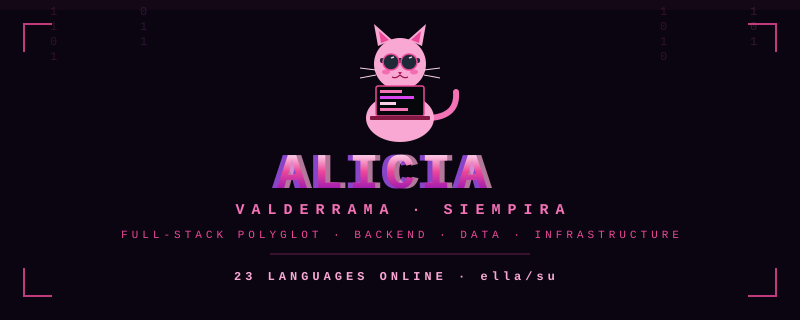
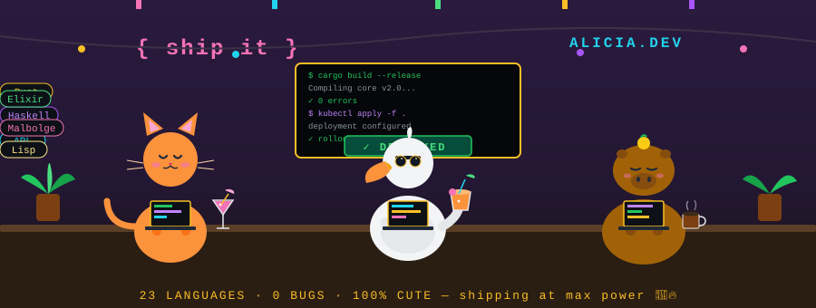

  

  
  
  
  

---

# ¡Hola! Soy Alicia Viviana Valderrama Siempira 💖
### Desarrolladora Full-Stack Políglota · Backend · Bases de datos · Infraestructura · `ella/su`

Desarrolladora full-stack con un enfoque **polyglot** — elijo la herramienta correcta para cada problema, no la de siempre. Me muevo cómodamente entre el **backend**, el **frontend**, las **bases de datos** y la **infraestructura**. Escribo código que escala, que se lee, y que no me avergüenza mostrar.

🌐 **[umbral.network](https://umbral.network/)** · 📍 Remoto / Mundial

  

---

### 🛠️ Arsenal Técnico

  
  
  
  
  
  
  
  
  
  
  
  
  
  
  
  
  
  

| Categoría | Tecnologías |
| :--- | :--- |
| **Lenguajes** | Python, Java, TypeScript, Go, Rust, C++, Haskell, Lisp / Clojure, Elixir / Erlang, Pascal |
| **Backend & Web** | Ruby on Rails, TypeScript, Tailwind CSS |
| **Bases de datos** | SQL / NoSQL, PostgreSQL, Redis |
| **Infraestructura** | Docker, DevOps |
| **Esotéricos (por diversión)** | APL / K / J, Prolog, Forth, Malbolge, Quantum Convict |

---

### 🚀 Lo que construyo

- ▸ **APIs robustas y sistemas distribuidos** con Go y Rust
- ▸ **Aplicaciones web full-stack** con TypeScript y Rails
- ▸ **Pipelines de datos y scripting avanzado** con Python
- ▸ **Interfaces modernas** con Tailwind CSS y componentes accesibles
- ▸ **Arquitecturas de bases de datos** relacionales y no relacionales

---

### 📊 Actividad

  

---

  <i>"Escribe código que te enorgullezca mantener dentro de un año."</i>

  

